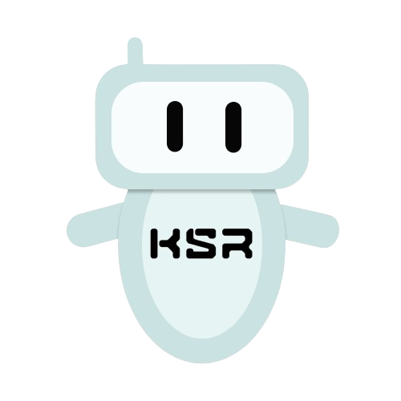
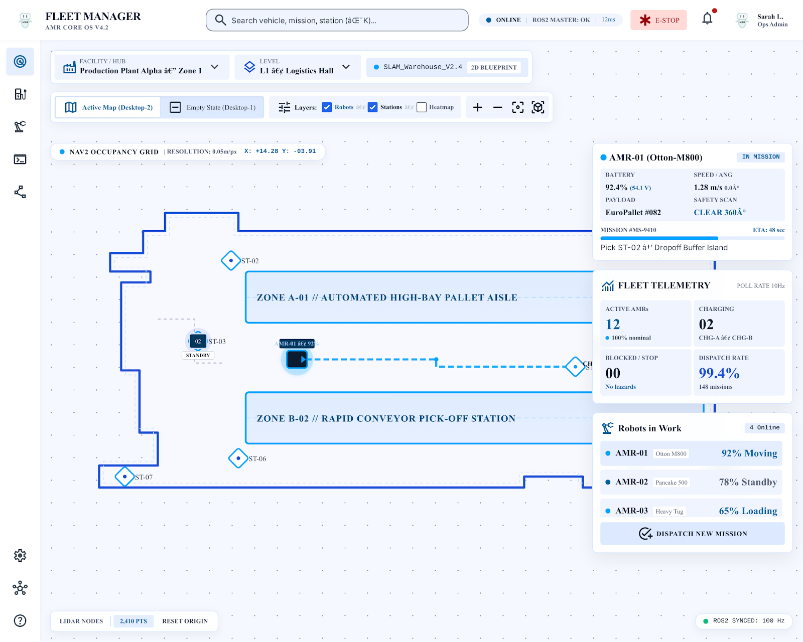
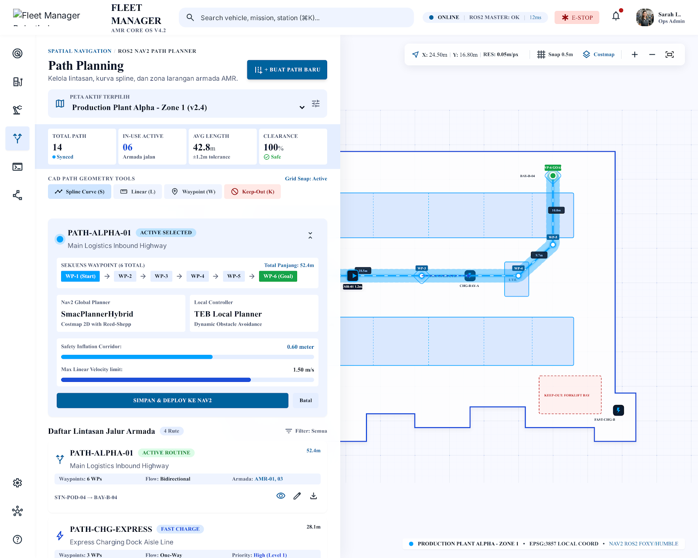
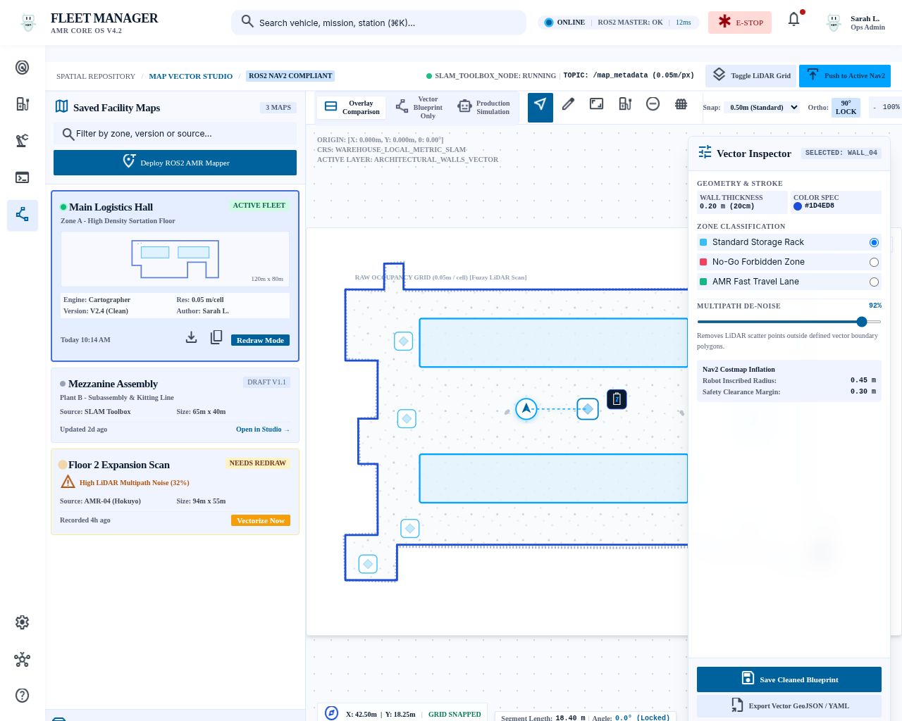
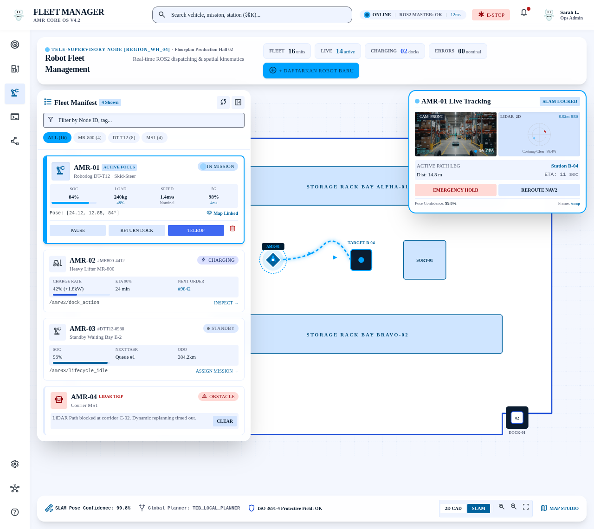
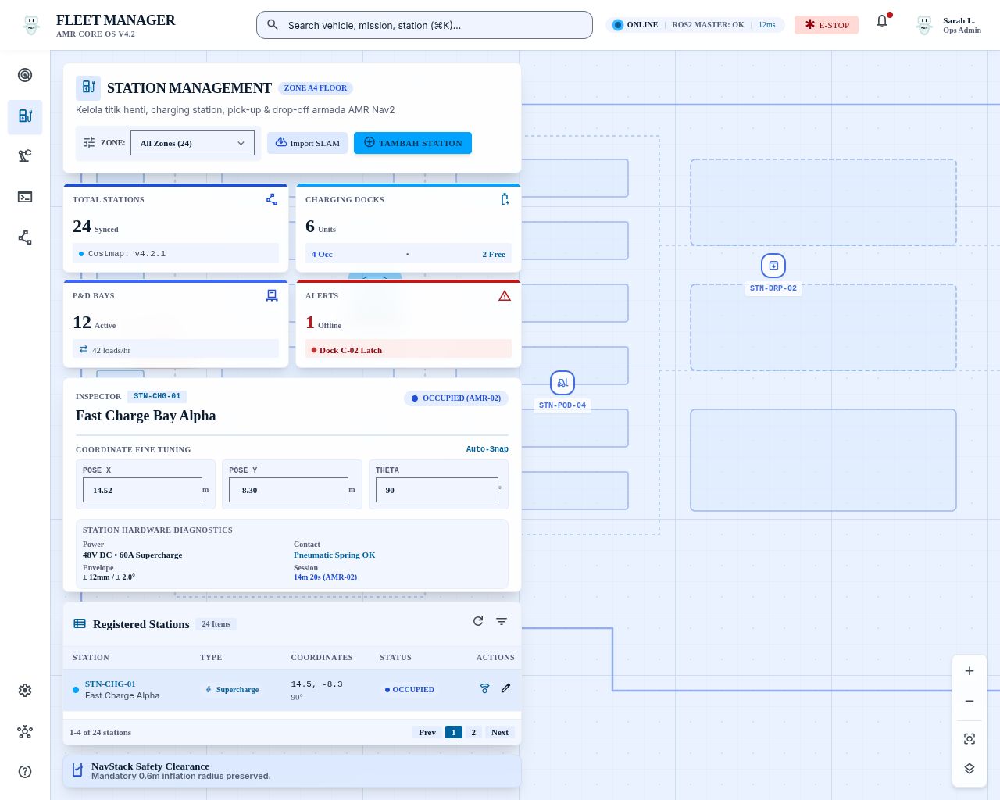
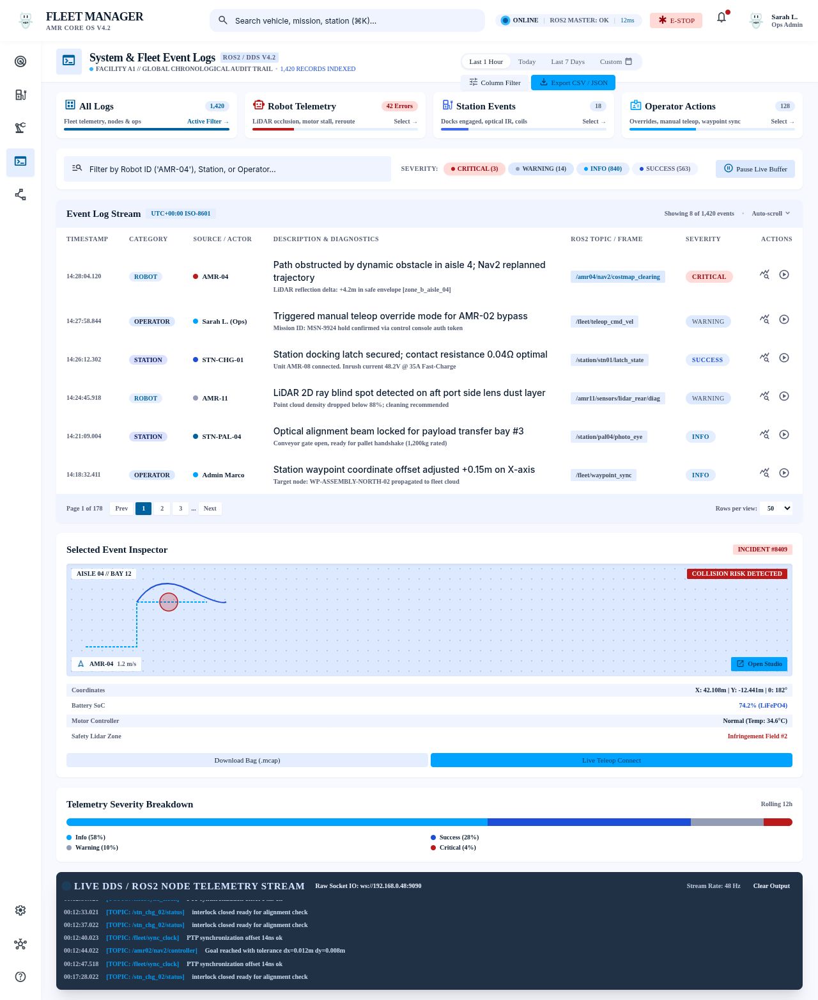

# 🤖 AMR Fleet Management & Tele-Supervisory System

<p align="center">
  
</p>

<p align="center">
  <strong>Autonomous Mobile Robot (AMR) Fleet Control • ROS 2 Nav2 Spatial CAD • Real-time Telemetry</strong>
</p>

<p align="center">
  <a href="https://laravel.com"></a>
  <a href="https://react.dev"></a>
  <a href="https://inertiajs.com"></a>
  <a href="https://www.typescriptlang.org"></a>
  <a href="https://docs.nav2.org"></a>
  <a href="https://tailwindcss.com"></a>
</p>

---

## 📸 Overview Showcase

An enterprise-grade tele-supervisory dashboard built for managing industrial Autonomous Mobile Robot (AMR) fleets. Integrates ROS 2 Nav2 occupancy grids, real-time telemetry streaming, interactive CAD path guideway planning, keep-out costmap filter masks, and docking station topologies into a single unified web platform.

<p align="center">
  
  <em>Interactive Live Map Telemetry Cockpit with real-time pose tracking, occupancy grid layering, and mission dispatch.</em>
</p>

---

## ✨ Key Features

- **🗺️ Live Telemetry & Supervisory Cockpit**
  - High-frequency (10Hz) streaming vehicle position updates $(x, y, \theta)$ with directional arrows and state-of-charge (SoC) gauges.
  - Interactive multi-layer blueprint canvas: ROS occupancy grids, restricted zones, lane networks, and AMR markers.
  - Instant Fleet E-Stop broadcast and teleoperation override commands.

- **🛣️ Spatial CAD Path Planning Engine**
  - Vector CAD guideway editor with magnetic snapping to docking stations and grid points.
  - $G^1$ Hermite fillet corner smoothing with configurable arc radii for non-holonomic mobile robots.
  - Orthogonal angle constraint modes ($45^\circ$, $90^\circ$, and Free drawing).
  - Bi-directional flow configuration and export to Nav2-compatible YAML waypoints.

- **🚫 Nav2 Costmap Filter & Keep-Out Mask Studio**
  - Interactive vector polygon drawing for Restricted Keep-Out Zones and Speed-Limit areas.
  - Real-time client-side coordinate transformation from canvas pixels to metric world coordinates $(m)$.
  - Direct PGM rasterizer for generating Nav2 costmap filter mask files.

- **📍 Station & Docking Bay Topology**
  - Management of Charging Hubs, Pick & Drop (P&D) Bays, Standby Buffers, and Inspection/QC stations.
  - Precision coordinate picking directly from 2D blueprints with 0.5m grid snap assist.

- **🤖 Robot Fleet Command & Teleop**
  - Unit status manifest (Active, Idle, Charging, Error, Maintenance).
  - ROS 2 Humble SSH tunnel bridge indicators.
  - Manual 2D pose re-localization estimate input directly synced to ROS `initialpose`.

- **📋 Audit & Telemetry Event Logs**
  - Centralized audit trail for fleet events, dispatch sequences, and sensor alerts with severity filtering.

---

## 🖼️ User Interface Gallery

| 🛣️ Spatial CAD Path Planning | 🏗️ Map Studio & Keep-Out Masks |
| :---: | :---: |
|  |  |
| *Guideway routing with tangential G1 corner fillets.* | *PGM / YAML package manager with keep-out polygon zones.* |

| 🤖 Robot Fleet Command | 📍 Docking Station Management |
| :---: | :---: |
|  |  |
| *AMR unit registry, telemetry stream, and manual teleop.* | *Charging bays, P&D transfer nodes, and Nav2 docking poses.* |

<details>
  <summary><b>🔍 Click to expand Event Logs & System Audit View</b></summary>
  <br/>
  <p align="center">
    
    <br/>
    <em>Centralized audit trail tracking system warnings, dispatch logs, and vehicle alerts.</em>
  </p>
</details>

---

## 🛠️ Architecture & Tech Stack

```mermaid
graph LR
    subgraph Frontend ["Frontend (Inertia + React 19)"]
        UI["Tailwind CSS + Lucide Icons"]
        Canvas["Interactive Blueprint Canvas (SVG + Zoom/Pan/Touch)"]
        Hooks["Modular Custom Hooks (useCanvasCursor, usePathEditor)"]
    end

    subgraph Backend ["Backend (Laravel 11 REST API)"]
        Controllers["Vehicle, Map, Pathplan, Waypoint Controllers"]
        DB[(SQLite / MySQL Database)]
        Proxy["Trusted Proxies / Cloudflare Tunnel"]
    end

    subgraph Robotics ["ROS 2 / Nav2 Ecosystem"]
        Nav2["Nav2 Path Planner & Controller"]
        Costmap["Costmap Filter Masks (Keep-Out / Speed Limit)"]
        Telemetry["AMR WebSocket / Telemetry Bridge"]
    end

    Frontend <-->|JSON API / Inertia| Backend
    Backend <-->|ROS2 Bridge / Exported YAML| Robotics
```



- **Runtime & Framework:** PHP 8.3+, Laravel 11 / 13
- **Frontend Stack:** React 19, TypeScript 5.7, Inertia.js v2, Tailwind CSS 3.4
- **Build Tool:** Vite 6 with HMR
- **Vector CAD Algorithms:** Custom geometric projection, Hermite spline corner fillets, polygon point-in-polygon & station snapping
- **Networking:** Native Cloudflare Tunnel (`cloudflared`) and reverse-proxy ready

---

## 🚀 Quick Start Guide

### Prerequisites
- **PHP** $\ge 8.3$ (e.g., via [Laravel Herd](https://herd.laravel.com/) or system PHP)
- **Composer** $\ge 2.2$
- **Node.js** $\ge 20$ & **npm**

### 1. Clone & Install Dependencies
```bash
git clone https://github.com/dionisioraditya/amr-management-fleet.git
cd amr-management-fleet

# Install PHP dependencies
composer install

# Install Frontend dependencies
npm install
```

### 2. Configure Environment
```bash
cp .env.example .env
php artisan key:generate
```

### 3. Database Migration & Seeding
```bash
touch database/database.sqlite
php artisan migrate --seed
```

### 4. Run Development Servers
In separate terminal tabs:

```bash
# Terminal 1: Backend API & Inertia server
php artisan serve

# Terminal 2: Frontend Vite HMR
npm run dev
```

Visit **`http://localhost:8000`** in your browser.

---

## 🌐 Remote Access & Cloudflare Tunneling

This project includes reverse-proxy configuration (`$middleware->trustProxies(at: '*')`) in `bootstrap/app.php` for seamless tunneling.

To start an instant public HTTPS tunnel for remote robot access:
```bash
cloudflared tunnel --url http://127.0.0.1:8000
```

---

## 📁 Project Directory Structure

```text
├── app/
│   ├── Http/Controllers/Api/   # REST API (Vehicles, Maps, Waypoints, Pathplans, Keepout)
│   └── Models/                 # Eloquent Models (Vehicle, FacilityMap, Waypoint, etc.)
├── docs/
│   └── screenshots/            # UI Showcase images for documentation
├── resources/
│   ├── js/
│   │   ├── components/fleet/   # Modular Fleet UI (Canvas, CAD Toolbar, Cockpits, HUD)
│   │   ├── hooks/              # Custom Hooks (useCanvasViewport, usePathEditor, etc.)
│   │   ├── lib/geometry/       # Geometric algorithms (fillet, snap, angle-constraint)
│   │   ├── pages/fleet/        # Inertia Pages (live-map, path-planning, map-studio, robots, stations)
│   │   └── types/              # TypeScript Interfaces & Fleet Domain Types
│   └── views/                  # Blade Entrypoint Layout
└── routes/
    ├── api.php                 # Core Fleet & Telemetry API Endpoints
    └── web.php                 # Inertia Web Routes
```

---

## 📄 License

This software is open-sourced under the [MIT License](LICENSE).
